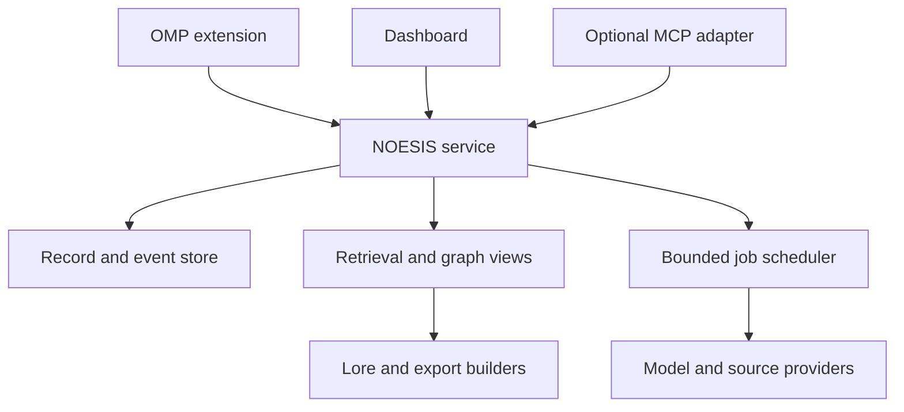

# NOESIS architecture

**Status:** proposed implementation contract. This bootstrap package specifies a system to build; it does not install a functioning Mind. Schema version `0.1.0` is a candidate contract, independent of the bootstrap package version.

Related documents: [product specification](01-PRODUCT-SPEC.md), [data model](03-DATA-MODEL.md), [service contracts](04-AGENT-AND-SERVICE-CONTRACTS.md), [learning and dreaming](05-LEARNING-AND-DREAMING.md), [dashboard and Lore](07-DASHBOARD-AND-LORE.md), [roadmap](09-ROADMAP-AND-RELEASES.md), and [validation](10-VALIDATION-AND-EVALUATION.md).

## 1. Purpose and boundaries

NOESIS supplies persistent memory, relevant recall, evidence-based learning, creative exploration, and continuity to every supported OMP workflow. Its concepts must work for software, research, writing, design, administration, planning, and future domains. FAR is one possible adapter, not the root of the data model.

The preferred shape is a native OMP extension backed by a host-independent local service. A dashboard and optional MCP adapter use the same service. The service owns policy, durable records, jobs, retrieval, and migrations. Clients do not write its database directly.

NOESIS complements existing systems:

| Existing responsibility | NOESIS contribution |
| --- | --- |
| OMP conversation and execution | Relevant experience and traceable cognitive services |
| Compaction | References to preserved decisions and evidence; no second conversation compactor |
| Task/goal coordinator | Continuity and observations; existing task ledger remains authoritative |
| Plugin workflow state | Evidence-linked lessons and improvement exports |
| Repository index | References and targeted retrieval; no mandatory second complete code index |
| Existing memory provider | Optional import/read adapter with explicit provenance and lifecycle mapping |
| Skills | Validated procedure candidates and versioned improvement proposals |

Remembering a permission does not grant a new permission. Remembering that something succeeded does not prove it succeeded. A derived explanation must retain its evidence and uncertainty.

## 2. Components

### OMP extension

The extension registers the eleven agent tools and a compact status/inspection surface. It observes supported host events, attaches authoritative transport identity, requests relevant recall, and reconciles outstanding capture receipts after reconnecting. It should contribute a short policy description and capability summary rather than injecting the complete manual into each turn.

M0 must inspect and pin the actual installed OMP version and its supported extension hooks. Do not assume that upstream Pi hooks, goal-loop events, worker events, or an old OMP example are compatible. Build an adapter capability table from observed exports and a small real-host probe. If a hook is absent, report the capture gap and use an explicit supported adapter operation; do not fabricate events.

### Local service

The service owns:

- Scope and authorization checks on every read, mutation, derivation, and export.
- Durable observations, sources, evidence, record revisions, and provenance links.
- Retrieval indexes and their freshness/coverage metadata.
- Learning transitions, application/outcome records, Ebb, and Lore derivations.
- Dream jobs, leases, checkpoints, cancellation, resource reservations, and cost accounting.
- Export manifests, retention/deletion coordination, backup, migrations, and health reporting.

The preferred implementation language is TypeScript. M0 must select and pin the service runtime, SQLite driver, packaging strategy, and IPC mechanism after checking the actual host. This document deliberately does not claim a particular Node/Bun/SQLite combination has passed integration testing.

### Dashboard

The dashboard explains what was retained, why it was recalled, what is uncertain, and what changed. It renders service projections and invokes the same commands as other clients. It must not implement independent promotion, sharing, or deletion logic in browser code. Follow [dashboard and Lore](07-DASHBOARD-AND-LORE.md).

### Optional MCP adapter

MCP exposes the existing service contract to other clients. It is a transport, not a second memory system. Read and write requests use the same authorization, idempotency, revision, and budget rules. A disconnected MCP client cannot bypass OMP or service permissions by describing a broader scope.

## 3. Local-first process model

Start with one service owner per configured data directory. Multiple OMP sessions and bounded workers may connect to it. Use SQLite on a supported local filesystem, with explicit transactions and the journal mode validated in M0. Do not place the live SQLite database on an arbitrary network share or create a separately writable database per client and pretend they are synchronized.

The proposed default is a LAN-accessible dashboard and API on `0.0.0.0:7337`, served from the same origin. Local-first describes where data and processing are controlled; it does not mean loopback-only access. The service advertises actual reachable LAN IPv4 URLs only after the listener is ready and prints a terminal text QR code for the selected URL. List valid interfaces when several are present; disclose a loopback fallback when no suitable LAN address exists. Hostname advertising is optional. A QR code contains the selected address, never a long-lived credential.

Private Mind reads and writes require pairing by default. Display a short-lived, one-use pairing code locally and exchange it for a revocable client session. Bind sessions to the configured service and enforce authorization, origin/CSRF checks, rate limits, and safe session storage. An unguessable record ID is not an authorization mechanism. The OMP adapter may use a separately provisioned local credential or a local socket, while the dashboard remains available on the LAN. Do not automate public port forwarding. M1 implements LAN binding, the terminal QR, pairing, and the same-origin API; M8 verifies and hardens real access from a second device. Multi-machine database synchronization remains a separate capability.

Separate inexpensive foreground work from queued work:

| Foreground | Queued or incremental |
| --- | --- |
| Validate scope, persist a capture receipt, return an acknowledgement | Model extraction, large source parsing, embeddings |
| Bounded lexical/metadata recall | Complex retrieval planning and large graph projections |
| Explain a selected record | Dreaming, Lore rebuilds, improvement exports |
| Request cancellation or a correction | Retention, derivative cleanup, and reindexing |

Every accepted asynchronous request returns a durable job ID. An acknowledgement means queued, not completed. Capture must not disappear because a provider is unavailable.

## 4. Baseline storage and indexes

The baseline is SQLite plus full-text search over normalized records. Suggested logical tables are `records`, `record_revisions`, `events`, `resources`, `source_snapshots`, `evidence_refs`, `relations`, `applications`, `jobs`, `job_steps`, `budget_reservations`, `outbox`, `index_state`, `deletion_jobs`, and `schema_migrations`. These are an implementation decomposition, not a requirement to duplicate identical fields in many tables.

Keep authoritative state distinct from rebuildable views:

- Original capture receipts and source/evidence manifests are authoritative for what was observed.
- Records and their revisions preserve interpretation and lifecycle decisions.
- Full-text/vector indexes, graph layouts, recall caches, and generated Lore sections are derivatives.
- Raw large content belongs in a content store addressed by verified digest where available; database rows retain its manifest and access scope.

An optional vector backend may improve conceptual recall. It must never become the sole store of provenance or the only means of retrieving an exact identifier. Graph views initially use explicit relation rows and bounded traversals; a separate graph database is not an initial dependency.

Rebuilding an index must not change a record's meaning. Index entries carry the indexed record revision, extraction/embedding model revision, configuration digest, and completed coverage. A half-built index is advertised as partial and is not silently treated as complete.

## 5. Resource identity and ingestion

A resource is distinct from its location, snapshots, and extracted claims. Examples include a URL, a local file, a repository object, a project, an installed tool, and a media artifact.

Identity rules:

1. Assign a stable internal resource ID and maintain location aliases.
2. Preserve the supplied locator separately from a versioned canonical locator.
3. Do not remove URL query parameters indiscriminately; some identify different content. Strip credentials and secrets from display/export locators.
4. Resolve local paths inside an authorized workspace. Record rename/relocation evidence rather than treating every path change as a new fact.
5. Identify repository content with repository identity, path, and exact commit/blob when known. Branch names are mutable locators.
6. Use `null` or `unknown` when a revision, timestamp, owner, or total size is unavailable. Do not fill gaps with plausible guesses.
7. Represent multimodal content by artifact references and ranges such as pages, frames, or seconds. A transcript or caption is a derivative, not the original image/audio/video.

An ingestion receipt records authorized scope, observed time, locator, snapshot status, parser/model version, content digest when computed, coverage, and errors. Preserve the distinction between source publication time, event time, retrieval time, and ingestion time.

## 6. Evidence and learning flow

The durable flow is observation → source/evidence → interpretation → candidate lesson or hypothesis → application → observed outcome → adoption/revision/retirement. It is not necessary for every observation to become a lesson.

An agent's statement that a test passed is an agent assertion. A captured command result is execution evidence. A passing exit code may still be insufficient to establish that the intended assertions ran. Keep these distinctions available to validators and exports.

Automatic low-risk capture, recall, corrections, and scoped adaptation should proceed within the user's configured authority and budget. Do not add an approval prompt for each lesson. Consequential actions retain the host's normal authorization requirements. NOESIS cannot authorize spending, publishing, sending messages, executing experiments, or changing another system merely because a dream proposed it.

## 7. Retrieval and context injection

Apply scope, status, validity, and compatibility constraints before ranking wherever possible. Retrieve a candidate union from exact identifiers, full-text matches, semantic matches when enabled, and explicit relationships. Deduplicate by record identity and revision, not by similar wording alone.

Every recall brief states why an item matches, its source, its freshness, and any uncertainty that affects use. Typical injection contains a few compact records with references. Details are fetched through `mind_inspect` or `mind_trace`.

Required behavior:

- Current explicit instructions take precedence over prior preferences.
- Retired procedures do not appear as active advice in ordinary recall.
- Historical queries may intentionally retrieve superseded records, clearly labelled.
- Missing evidence or incomplete source coverage is exposed.
- Tool/version mismatch narrows or rejects applicability.
- Partial index failure degrades to available lexical/metadata recall and reports the limitation.
- A relevance score is not a confidence score or permission level.

## 8. Ebb, Lore, and creative work

Ebb changes reversible activation using elapsed time and relevant opportunities. It does not change truth, confidence, validity, or retention. Explicit constraints, open commitments, and manually pinned records are protected. See [learning and dreaming](05-LEARNING-AND-DREAMING.md) for the anchored calculation and finite run limits.

Lore is a navigable, source-linked view of knowledge. Generated sections carry source manifests and coverage. Manual sections are separately owned and preserved. A generated Lore page cannot become independent evidence for the very claims that produced it. A new external source cited by that page may supply additional evidence only after ingestion as its own source.

Dreaming uses the same records and scopes but creates explicitly imaginative or inferred outputs. Snooze/Nap/Dream/Deep Sleep set effort, modes set activity, and focus selects a target. The first useful release includes a deterministic Snooze; later M4 work adds model-assisted synthesis and creative modes. Deterministic Snooze performs housekeeping and proposes work; it does not manufacture semantic insights.

## 9. Consistency, concurrency, and recovery

Use append-only events plus versioned record mutations. A mutation includes an idempotency key and expected revision. Repeated delivery returns the original result; a changed body using an existing key is an error. Competing updates return a conflict rather than overwriting another writer.

Workers operate under expiring leases with fencing tokens. A worker whose lease expires cannot commit after a replacement worker takes ownership. Source parsing, extraction, and index steps are individually checkpointed. A resumed job accounts for prior usage and never receives a fresh full budget accidentally.

Commit the authoritative change and its outbox event together. Index updates and notifications may follow asynchronously, with lag visible. Crash recovery reconciles outbox state and abandoned leases. It must not count an unacknowledged external model call as free; reserve conservative cost and reconcile from provider receipts when available.

## 10. Deletion, migrations, and implementation gates

Retention expiry is eligibility under an explicit policy, not an Ebb action. Deletion must consider raw artifacts, records, revisions, indexes, caches, Lore derivatives, export copies under service control, and backups. Record minimal deletion receipts without retaining the content the user requested removed. External exports already delivered to another location cannot be silently recalled; report that limit.

Migrations are numbered, transactional where supported, backed up, and accompanied by a restore procedure. An unsupported newer schema opens read-only or fails clearly; it does not silently downgrade. Preserve unknown imported fields in quarantined raw artifacts, not by inserting them into a closed validated schema as if understood.

M0 acceptance for this architecture is evidence of the real OMP adapter and runtime choices, the authentication design, a durable capture/recall probe, and a recorded capability/coverage report. M1 supplies the working LAN service and client pairing. Later milestones must satisfy the [roadmap](09-ROADMAP-AND-RELEASES.md) and [validation plan](10-VALIDATION-AND-EVALUATION.md). Documentation and sample schemas are not substitutes for these execution results.
