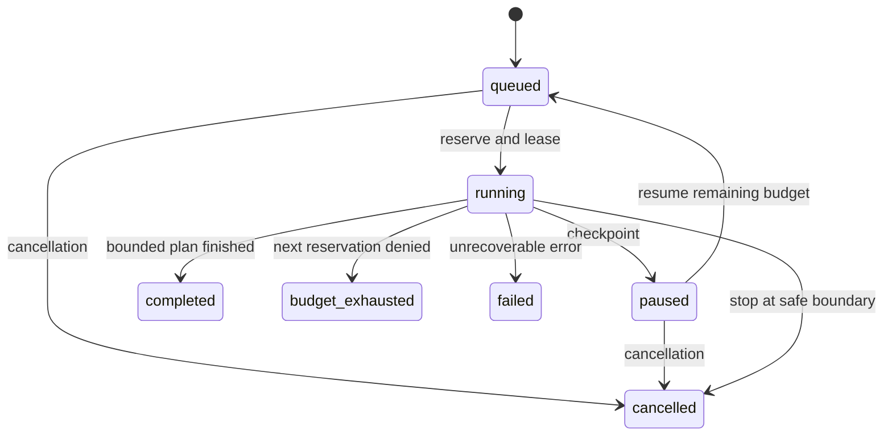

# Learning, Ebb, and dreaming

**Status:** design for implementation. NOESIS should remember useful experience, learn from actual outcomes, and create possibilities that were not stated explicitly in a source. Those activities share provenance and budgets but have different claims to truth.

## 1. Separate the cognitive operations

| Operation | Question it addresses | Output |
| --- | --- | --- |
| Recall | What relevant knowledge or experience is already available? | Ranked records with applicability and sources |
| Reflection | What happened, and what explanation is supported? | Episode interpretation and candidate lesson |
| Assessment | What does this imply for the current choice? | Contextual advice, uncertainty, next checks |
| Dreaming | What connections, alternatives, or futures could be worth exploring? | Hypotheses, analogies, rehearsals, questions, Blueprints |
| Experiment | What happens when a concrete change is tried? | Application and actual outcome evidence |
| Learning | Which recommendation should change after evidence arrives? | Scoped adoption, revision, restriction, or retirement |

No operation automatically executes the next one. A dream can propose a test; execution occurs through an authorized task with its own application record. A result can support a lesson; its scope and alternative explanations still matter.

## 2. Observation to useful learning

Capture an event or source before deriving interpretations. Preserve its original scope, actor, relevant resource versions, timestamps actually known, and coverage. Group repeated records by their underlying event so retries and summaries do not become multiple independent successes.

A candidate lesson contains a trigger, recommendation, rationale, applicability conditions, exclusions, expected benefit, evidence references, validation state, and retirement/revalidation conditions. Use narrower scope when observations do not support a universal rule. A useful default can be adopted autonomously when it is low risk, reversible, inside existing authority, and has enough support for that context. Record the reason; do not require the user to approve every lesson.

The service must retain different states for factual confidence, current validity, recommendation adoption, activation, and retention. A low-activation lesson can be valid and well supported. A frequently recalled lesson can be wrong. A correct historical fact can be inapplicable to the current tool version.

### Preference learning

An explicit preference is a direct user statement with a source. An inferred preference is a pattern with its context and contrary evidence. Repeated observation does not turn an inference into an explicit instruction. Current explicit instructions control the current task; old preferences do not override them.

Preferences can adapt without constant questioning. Ask when a materially consequential ambiguity remains after checking available context. Preserve explicit constraints and open commitments until corrected, fulfilled, or deliberately retired, even if they are rarely recalled.

### Outcome learning

Record that a lesson was used, what action changed, what result was observed, and what else could explain that result. Useful feedback is valuable but distinct from measured improvement. An absent complaint is unknown feedback. An agent saying that it succeeded is a report until linked to the relevant result.

Repeated failures may narrow or retire a lesson automatically under policy. Contradictions create a visible conflict or scoped alternatives. A tool upgrade schedules compatibility revalidation; it does not automatically refute every prior lesson or transfer all old confidence to the new version.

## 3. Ebb: finite, reversible activation fading

Ebb helps the Mind avoid repeatedly surfacing low-value material. It changes activation only. It never deletes a record, weakens factual confidence, resolves a contradiction, changes validity, or retires a recommendation by itself.

Use an anchored calculation so rerunning maintenance does not repeatedly punish the same elapsed interval. One candidate formula is:

```text
activation = floor + (anchor_score - floor)
             * exp(-lambda_time * elapsed_days
                   -lambda_opportunity * relevant_opportunities)
```

This is a configurable engineering heuristic, not a claim about biological memory. `anchor_score`, `anchor_at`, eligible opportunity count, policy version, and last evaluation are explicit. Scores remain in `[0,1]`. A recorded meaningful use or policy-approved reinforcement creates a new anchor; simply reading a page, regenerating Lore, or running Snooze must not fabricate reinforcement. A repeated evaluation with unchanged inputs produces the same score.

Relevant opportunities are opportunities in which the record could reasonably have helped, not every unrelated user interaction. A coding preference should not fade because the user spent a week planning travel. If no reliable opportunity signal exists, use elapsed-time fading alone and report that limitation.

Protection rules are explicit: direct constraints, open commitments, and manual pins do not fade below their protected minimum. Unpinning changes future activation behavior; it does not revoke validity or delete history. Retention eligibility is evaluated by a separate bounded policy with its own preview and deletion flow.

Each run has a finite record count and time limit, a stable cursor, a policy revision, and a durable checkpoint. It processes only changed/due records. Repeated scheduling must not create an endless loop. A normal recall or exact lookup can still surface faded knowledge when relevant, with its lifecycle labels intact.

## 4. Dream controls: level, mode, focus, and scope

The names are experience labels, not scientific sleep stages. Level controls effort. Mode controls the kind of thinking. Focus controls the question. Scope controls which records may be used. Increasing depth never increases authority or turns an idea into truth.

### Effort profiles

The following are initial design defaults for local jobs. They must be reconciled with the configured global/user/session budget and measured in implementation. They are upper bounds, not targets to fill. Provider prices determine cost; these limits do not assert a price.

| Level | Intended use | Source records | Model calls | Total model tokens | Wall time | Child jobs |
| --- | --- | ---: | ---: | ---: | ---: | ---: |
| `snooze` | Small housekeeping and a short next-work queue | 100 | 0 initially | 0 initially | 30 s | 0 |
| `nap` | One focused synthesis or a few alternatives | 150 | 3 | 12000 | 90 s | 1 |
| `dream` | Several connections and a useful proposed direction | 400 | 8 | 40000 | 300 s | 3 |
| `deep_sleep` | Scheduled broader exploration and consolidation | 1200 | 20 | 100000 | 900 s | 6 |

Output and concurrency caps are separate from the number of child jobs:

| Level | Maximum output records | Maximum concurrent workers |
| --- | ---: | ---: |
| `snooze` | 100 | 1 |
| `nap` | 25 | 1 |
| `dream` | 50 | 2 |
| `deep_sleep` | 100 | 2 |

The child-job cap is the total number created over the root job's lifetime, not the number running simultaneously. These defaults correspond to [the draft policy example](../config/noesis.example.json); it is a planning artifact until an implementation validates and consumes it. The accepted job receipt resolves the effective policy and all limits explicitly.

The budget also needs a currency-denominated spend cap when paid providers are enabled, bounded output count, token accounting completeness, and maximum concurrency. Child work counts against the same root totals. A global daily cap can stop a job before its profile cap. Unknown model pricing blocks paid dispatch unless a conservative configured reservation is available. Durations are scheduler bounds, not permission for the user-facing agent to block without updates.

First useful release: deterministic `snooze` with `consolidate`. It deduplicates repeated event IDs, updates due Ebb scores, detects mechanical version/lineage problems, identifies stale derivatives, and queues bounded follow-up work. It can find exact conflicts in structured fields; it must not claim to understand all semantic contradictions without a model. It does not invent creative insights. M4 adds the model-assisted profiles and modes after budgets and durable jobs work.

### Modes

| Mode | Useful activity | Typical output |
| --- | --- | --- |
| `consolidate` | Compare related records, compress a bounded cluster, preserve exceptions and conflicts | Candidate summary, duplicate proposal, unresolved conflict |
| `associate` | Find a useful analogy or connection across allowed domains | Analogy with shared structure, limits, and source links |
| `imagine` | Create alternatives, designs, combinations, and possible futures | Concept, Blueprint, or possibility with assumptions |
| `rehearse` | Explore counterfactuals and likely failure paths | Imagined scenario, predicted consequences, proposed checks |
| `reframe` | Challenge a default interpretation or pose a better question | Alternative framing or research question |

Modes may be combined within one finite budget. A UI preset named `mixed` resolves to an explicit array of modes in the accepted job; it is not a sixth unbounded activity. `focus` can be open or targeted, with a query and selected record/resource references. A targeted focus is the equivalent of lucid direction; it need not be a fifth effort tier. Broad focus still respects scope boundaries. Cross-domain association may only use domains the job is allowed to read and combine.

## 5. Dream job lifecycle



`budget_exhausted` is terminal for that execution budget. Additional work requires an explicit budget amendment under existing authority or a linked new job; preserve the original spending and reason. `failed` retains completed outputs with their status. Cancellation prevents new dispatches and asks in-flight providers to stop where supported; already charged work remains in accounting.

A durable job stores the accepted profile, actual limits, authorized scopes, input revisions, root/parent IDs, mode/focus, planned steps, output references, coverage, reservations, usage receipts, lease, and checkpoint. The worker must renew its lease and present a fencing token to commit. A replacement worker resumes from durable checkpoints, never from a falsely fresh budget. All child calls and child jobs are charged to the root even when they fail or produce no accepted insight.

### Processing sequence

1. Resolve authorized scopes, requested capability, focus, and finite budget. Persist the accepted job before dispatch.
2. Select a diverse but bounded set of relevant records. Expose gaps, stale versions, counterevidence, and omitted scopes.
3. Build a source map with exact record revisions and original event groups. Do not count summaries of the same event as corroboration.
4. Run the selected activities. Label imaginative statements at creation time, not as a final cleanup step.
5. Challenge promising ideas for unsupported assumptions, scope leaks, version conflicts, and obvious counterexamples. Critique can improve an idea; it cannot make an imagined outcome observed.
6. Save a limited number of distinct outputs, with novelty/utility rationale and next validation. Preserve valuable unresolved questions. Do not fill an output quota with restatements.
7. Publish a compact completion receipt, source/coverage manifest, actual usage, pending follow-ups, and any partial result reason.

Repeated jobs should discover prior outputs and avoid spending the same budget rephrasing them. Store a fingerprint of focus, mode, source revisions, and transformation version for reuse; do not suppress a rerun after meaningful new evidence or a changed question.

## 6. Output types and epistemic status

All imaginative content is a `hypothesis` record or a typed Blueprint finding until a separate real application supplies evidence. Supported/refuted hypotheses retain their origin; a resulting lesson is a new linked record. Do not erase dream provenance when adopting a useful idea.

| Output | Required content | What it may claim |
| --- | --- | --- |
| Candidate insight | Statement, source links, reasoning, applicability, counterevidence | A potentially useful interpretation |
| Analogy | Source and target structure, meaningful similarity, disanalogies | A transfer worth considering |
| Creative concept | Proposed idea, assumptions, alternatives, expected benefit | A possibility that may be novel/useful |
| Counterfactual rehearsal | Starting conditions, imagined sequence, predicted outcomes | What might happen under assumptions |
| Open question | Missing information, why it matters, feasible next check | An unresolved gap |
| Relation proposal | Endpoints, inferred relation, basis, confidence | A candidate connection |
| Blueprint | Target, observed findings vs ideas, proposed changes, validation, rollback | A concrete proposal, with evidence boundaries |

Imagined timings, success rates, reactions, or test results stay predictions. A simulation is an actual simulation run only if it was executed and captured, and its results remain evidence about that simulation and its assumptions. It is not a real-world outcome merely because the simulator completed.

### Cross-domain example

A project retrospective shows that editing a complex document improved when structural review happened before sentence polishing. A separate software task shows that changing an API before clarifying invariants caused rework. An `associate` dream proposes a shared procedure: stabilize the structure or contract before optimizing surface details.

That transfer is a hypothesis, with two distinct sources, applicability limits, and possible exceptions such as intentionally exploratory prototypes. A later writing task can apply it and record revision time and user feedback. Only those real observations support a writing lesson. The analogy itself does not prove that the same procedure improves every domain.

## 7. Autonomous and on-demand work

On-demand dreams run because the user or authorized agent asks for them. Autonomous dreams run only under configured triggers and finite budgets: for example, a bounded idle window, enough new evidence in a scope, a repeated unexplained failure, or a due compatibility review. Autonomy is not permission to keep working without a stop condition.

Initial defaults favor inexpensive deterministic Snooze. Optional Nap/Dream scheduling requires an enabled provider and assigned budget. Deep Sleep is opt-in or explicitly requested because its broad exploration can consume more resources. The scheduler yields to active work, caps parallelism, and avoids waking many duplicate jobs for the same evidence.

Automatic learning may create candidates, adjust reversible activation, narrow applicability, correct derived summaries, or adopt a supported low-risk recommendation. Changing a plugin, writing a skill, running an experiment, publishing an issue, or sending an improvement pack is a separate action governed by existing user authority. Do not add a new permission gate merely because NOESIS produced the idea.

## 8. From dream to component improvement

An improvement Blueprint names the exact plugin/tool/component and the relevant versions or explicitly unknown version range. It separates observed behavior, candidate root causes, creative opportunities, proposed changes, and validation status. Attribution may be component, usage, configuration, host, dependency, mixed, or unknown. Include evidence for the attribution, not just proximity to the component.

Export statuses distinguish `observed_finding`, `inferred_explanation`, `dreamed_idea`, `proposed_change`, and actual validation results. A dreamed feature may be valuable without a demonstrated bug. It must not be presented as a confirmed defect or measured improvement.

After an upgrade or implemented change, rerun selected transferable regression cases under the new version, record outcomes and cost, and update compatibility. Retire resolved workarounds when evidence supports it. Preserve failures and regressions. Exported cases must be privacy-redacted and reproducible with the supplied context, or explicitly described as incomplete.

## 9. Evaluation and stopping rules

Measure whether NOESIS helps on tasks it did not use to formulate its lessons. Use comparable contexts, held-out cases, and baseline runs where practical. Separate recall quality, task outcomes, cost, latency, user corrections, provenance accuracy, and creative usefulness. Repeated testing on the same case does not establish general improvement.

Creative outputs can be assessed for usefulness, diversity, fidelity to constraints, and whether they lead to worthwhile experiments. Their imaginative quality is not a factual confidence score. Negative results and no useful idea are legitimate outputs; do not force a breakthrough from every dream.

Stop a job when its plan is done, the remaining steps have low expected value, a required source is missing, cancellation occurs, the lease is lost, or a finite budget is exhausted. Surface the actual reason and useful partial outputs. Never conceal an incomplete job as a completed period of reflection.

See [validation](10-VALIDATION-AND-EVALUATION.md), [operations and budgets](11-OPERATIONS-AND-BUDGETS.md), and [roadmap](09-ROADMAP-AND-RELEASES.md) for implementation acceptance and release boundaries.
