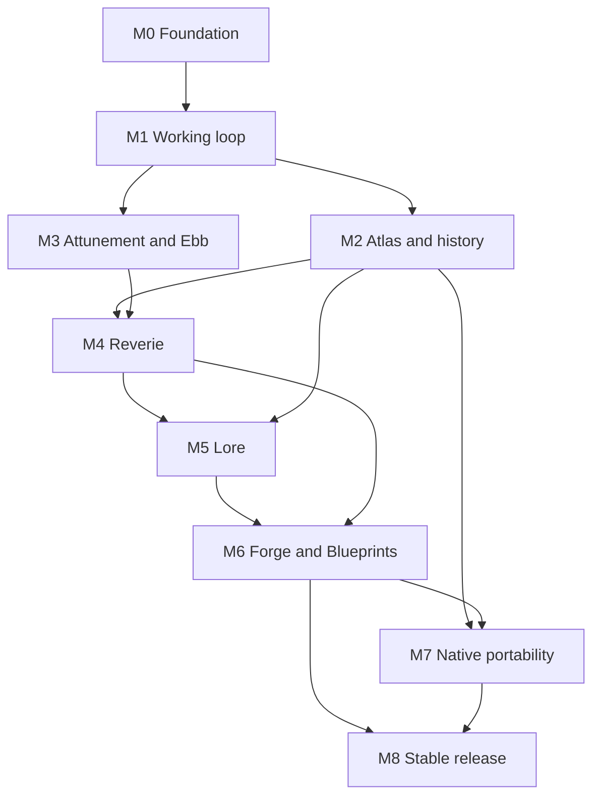

# Roadmap, milestones, and release goals

NOESIS is a universal Mind for Oh My Pi. The first implementation should prove a useful end-to-end loop quickly: capture real experience, recall relevant evidence, inspect it in a working LAN-accessible web application, and run a small durable `mind_dream` job. Subsequent releases build on that working loop.

This document is a planning baseline, not an implementation report. **Every milestone and task is planned. The product is unreleased.** The `1.0.0` in the bootstrap package name versions these instructions and plans only.

## Planning assumptions

- One primary contributor works approximately five engineering days per week, with bounded assistance for independent tasks and one integration owner. An engineering day is an effort estimate, not a guaranteed unit of calendar delivery.
- The first release targets one verified OMP/environment combination. M0 decides the runtime, package manager, adapter contract, supported platform, and executable validation commands using current evidence.
- The initial architecture is local first and lightweight. A reusable core and native OMP adapter are candidates to verify in M0; LangChain memory, SimpleMem, Cognee, or a graph database are not mandatory dependencies.
- An existing model/provider configuration can support optional model work. Exact model costs and performance remain measured implementation questions. Capture, inspection, and deterministic maintenance should remain useful without paying for an enrichment run.
- The roadmap includes the complete requested feature scope, including the Observatory web application. Early releases deliberately ship a narrow working slice; later milestones expand it.
- Review and relevant validation are included in each estimate. External approvals, account provisioning, upstream breakage, major migration surprises, and lengthy interruptions are not predictable engineering effort and require replanning.
- Parallel work is limited by available contributors and contract stability. Equal-quality agents do not remove integration, review, or shared-file bottlenecks. No date below assumes unbounded parallelism.

## Timeline envelope

The effort ranges total **59–86 engineering days**, or roughly **12–18 working weeks** for the assumed primary contributor. This is a planning envelope, not a deadline promise. Re-estimate after M0 and after the first working M1 release using actual throughput and the measured costs of capture, retrieval, dreaming, and UI integration.

The cumulative columns below are a conservative mostly serial planning view. Independent lanes can overlap; unused concurrency is not a reason to manufacture more work.

| Milestone | Effort | Cumulative effort | Product target | Release goal |
| --- | ---: | ---: | --- | --- |
| M0 — Verified foundation | 3–5 days | 3–5 days | No release | Verify the environment, contracts, ownership, validation commands, and implementation scaffold. |
| M1 — Working Mind loop | 10–14 days | 13–19 days | `v0.1.0-alpha.1` | Real event ledger, native OMP capture, scoped recall, inspector, working LAN Observatory with terminal QR and pairing, and durable Snooze. |
| M2 — Atlas, Lineage, Chronicle | 7–10 days | 20–29 days | `v0.2.0-alpha.1` | Known resources across local and external work, immutable evidence snapshots, provenance, and history. |
| M3 — Attunement and Ebb | 5–7 days | 25–36 days | `v0.3.0-alpha.1` | Correctable preferences and reversible activation fading with explicit forgetting kept separate. |
| M4 — Full Reverie | 9–13 days | 34–49 days | `v0.4.0-alpha.1` | All dream levels and modes, Retrospection, focused runs, bounded rehearsal, and inspectable outputs. |
| M5 — Lore | 6–9 days | 40–58 days | `v0.5.0-beta.1` | Living sourced wiki with manual sections, diffs, backlinks, and dependency invalidation. |
| M6 — Forge and Blueprints | 7–10 days | 47–68 days | `v0.6.0-beta.1` | Resource-specific improvement views, focused dreams, and portable evidence-backed improvement guides. |
| M7 — Native portability and optional adapters | 4–6 days | 51–74 days | `v0.7.0-beta.1` | Required native archive, integrity verification, and restore; selected MCP or external adapters preserve the same policies. |
| M8 — Hardening and stable release | 8–12 days | 59–86 days | `v1.0.0-rc.1` → `v1.0.0` | Supported workflows survive failure, restore, migration, and clean installation with documented limits. |

No calendar dates are implied. A missed estimate changes the forecast; it does not justify silently dropping a requested capability or weakening a release gate. If scope needs to move, record the decision and its effect on the release goals.

## Dependency graph and parallel work

The expected critical dependency path is **M0 → M1 → M2 → M4 → M5 → M6 → M7 → M8**. This includes M7's required native archive, integrity verification, and restore; it does not require a costly optional MCP or external-backend adapter. M3 is also required before full Reverie and can become critical if it runs late. The one-contributor effort envelope includes M3's work; a graph branch does not make that effort disappear.

Useful parallel lanes are bounded:

| Lane | Can start when | Boundary |
| --- | --- | --- |
| Storage and native adapter | M0 contracts are accepted | Serialize schema, migration, and lockfile ownership; integrate one candidate at a time. |
| Observatory views | The relevant contracts and a real data path exist | Use stable fixtures for isolated development, then prove acceptance against the real runtime. |
| Attunement and Ebb | M1 capture and scope semantics are accepted | Do not wait for every Atlas view; reconcile resource identity with M2 before M4. |
| Native portability and optional MCP contract spike | M2 scope and provenance contracts are stable | Native restore acceptance depends on M6 and the shared core. Start MCP implementation only if selected; it does not gate native portability. |
| Evaluation and documentation | A concrete behavior and its acceptance criteria exist | Prepare meaningful cases alongside implementation; do not claim tests passed in advance. |

Task-level dependencies in `planning/backlog.json` govern when individual work can start. Milestone dependencies govern completion and release readiness. An early spike does not complete its later milestone.

## Milestone exit criteria

### M0 — Verify before committing to architecture

Produce the actual OMP hook/tool contract, supported environment record, repository ownership rules, initial schema and adapter decisions, and a command map for the validation targets. Establish application CI only after identifying the real application toolchain. Record unresolved architectural choices with bounded experiments rather than adding every memory framework. No product release is claimed.

### M1 — Ship a real working slice

An actual OMP session produces persisted attempts and outcomes. Recall returns relevant scoped evidence with inspectable provenance. The Observatory displays real captured data, supports recall and inspection, and shows durable Snooze job state through Pulse. Its same-origin UI/API defaults to a LAN listener at `0.0.0.0:7337`. After a successful listen, startup advertises an actual interface address and prints a terminal text QR for that address; it never encodes `0.0.0.0` or a secret in the URL. Multiple suitable interfaces are listed with a way to choose the advertised address. A short-lived code shown in the local console pairs a client before any private Mind read or write. Startup, bind failures, address selection, QR correctness, pairing expiry, and unauthorized requests have integration coverage.

A Snooze consolidates a bounded set of records, can be interrupted safely, and does not turn a generated statement into a verified fact. A fresh installation can exercise the entire loop through a documented command or automated journey. The first release includes this working web application and LAN onboarding rather than deferring them to a later milestone.

### M2 — Understand resources and history

Atlas catalogs plugins, tools, skills, MCP servers, webpages, websites, repositories, projects, workflows, APIs, documents, and datasets, with local/external/mixed facets. Referenced, examined, available, installed, used, and evaluated are independent properties supported by evidence; evaluation does not imply a positive result or verification. Source snapshots and versions support Lineage's source, derivation, retrieval, context-inclusion, application, and outcome traces, while Chronicle preserves history, corrections, and disputes. Search/list/graph/timeline exploration is bounded and paginated, includes a non-graph alternative, and can expose dormant records without confirming them. At least one local resource and one external webpage are exercised end to end, including a change in source content.

### M3 — Adapt without inventing confirmation

Attunement distinguishes stated preferences from inferred patterns supported by independent contexts; current instructions and user corrections override inferences, and silence is not confirmation. Ebb moves activation among active, quiet, and dormant reversibly, independently of truth, validity, and retention. Applicable explicit constraints and open commitments remain available despite inactivity, and revival preserves rejection reasons and counterevidence. Repeating maintenance at the same effective time does not double decay. Explicit forgetting reconciles controlled indexes, caches, and generated derivatives under its own documented lifecycle. The UI explains and permits correction of these states.

### M4 — Make dreaming a complete, bounded capability

`mind_dream` supports `snooze`, `nap`, `dream`, and `deep_sleep`; five concrete modes, `consolidate`, `associate`, `imagine`, `rehearse`, and `reframe`; and independent scope and focus controls. `mixed` is a UI/tool preset that expands into an explicit unique `job.modes` array of concrete modes, not a sixth stored cognitive mode. Lucid describes intentional focus, not another effort level. Retrospection reviews experiences and their outcomes. Creative output stays labeled as a hypothesis or proposal. Rehearsal distinguishes simulated reasoning from actual authorized experiments and records which occurred. The job system counts child calls, retries, embeddings, and tool work against the same hard limit, and reports budgets, interruptions, pending work, and results honestly. Candidate learning/retrieval policy changes use independent held-out evaluation before reversible promotion, with a working rollback to the accepted version.

### M5 — Grow Lore from sources

Lore produces readable sourced pages with stable identities, backlinks, manual sections, and reviewable diffs. Source changes invalidate dependent generated sections, and manual content survives regeneration. A generated page cannot count its own descendants as independent confirming evidence. The web application supports reading, editing, and inspecting the source chain.

### M6 — Turn learning into component improvements

Forge filters evidence to a selected resource and version, surfaces observed friction and successful patterns, and launches bounded focused dreams. Blueprints export a readable guide plus structured records containing evidence, suggestions, reproduction cases, versions, omissions, and limitations. Delta exports identify a prior export and carry scoped additions, revisions, invalidations, and deletion markers with explicit coverage. An incompatible baseline yields an explicit error or declared full-export fallback. Test one plugin/tool target and one non-plugin target such as a project or web source. Exporting guidance does not automatically patch the source or activate imported advice as trusted memory.

### M7 — Require native portability; select adapters individually

The native archive, integrity verification, and clean-store restore are required v1 capabilities. They preserve supported identities, revisions, scopes, source references, and lineage with explicit coverage and omission reporting. Native portability works without MCP, COGX, or an external memory backend. M7 cannot be skipped as a whole.

The task flags make this distinction concrete:

| Tasks | v1 obligation | Completion rule |
| --- | --- | --- |
| M7-01, M7-04, M7-05, M7-06 | Required native contracts, archive/integrity/restore, native-only validation, and release disposition | Complete with observed evidence before the required M7 gate closes. |
| M7-02, M7-03 | Optional MCP implementation and transport policy | Complete if selected, or mark explicitly deferred with a scoped reason. Do not advertise deferred tools. |
| Separately selected external formats/backends | Optional extensions, such as COGX conversion | Add a bounded task only when selected; report actual mapping losses and keep native guarantees intact. |

When selected, the MCP adapter exposes the agreed core tools, including `mind_dream`, with the same scoping, budget, provenance, cancellation, and error semantics. A supported client can use the core without bypassing policies. Optional external formats disclose losses instead of silently increasing trust. M8 may proceed once required M7 work and selected optional work are accepted and unselected optional items have explicit deferral records. Costly optional adapters do not become a hidden prerequisite for the native product.

### M8 — Stabilize the promised product

Exercise crash recovery, migrations, backup/restore, source invalidation, forgetting, scope boundaries, and installation on the declared supported environment. Measure latency and resource use against explicit budgets selected from observed workloads. Verify actual LAN access and pairing from a second device when one is available. If it is unavailable, state that precise physical-validation limitation and retain the automated startup/address/pairing evidence; do not invent a passed device check or substitute an unrelated manual gate. Prepare a reproducible release candidate, resolve release-blocking defects, and rerun the affected checks. Produce truthful release notes and known limitations, then prepare the stable local artifact. Remote publication remains a separate authorized action.

## Evidence and release discipline

The machine-readable plan contains six concrete tasks per milestone. A task is done only when its outputs exist, its acceptance criteria are met, and its evidence references identify the tested candidate and observed result. A milestone is complete only when its required tasks and exit criteria are satisfied. A passing bootstrap validator does not complete M0 or any runtime task.

Use `templates/MILESTONE-REPORT.md` for milestone closure, `templates/VALIDATION-REPORT.md` for exact candidate/command/results, `templates/DECISION.md` for material choices, and `templates/RELEASE-NOTES.md` for product candidates. `docs/14-REQUIREMENTS-TRACEABILITY.md` maps the product requirements to concrete tasks and behavioral scenarios. Record failures and limitations directly. Human feedback is welcome but a mandatory human QA ceremony is not a completion gate; automated checks, agent review, and observed working behavior can establish readiness.

Keep gates proportional. Add a test or extra review only to resolve a concrete risk, verify an invariant, or meet an already agreed compatibility promise. Do not broaden a finished milestone indefinitely. New feature requests become explicit backlog changes with dependency and schedule effects.

Alpha releases establish useful slices and evolving contracts. Beta releases establish coherent workflows and portability while allowing documented fixes. Release candidates freeze the intended v1 scope. Stable `v1.0.0` means the documented supported workflows meet their measured gates; it does not promise universal model accuracy, unlimited memory, or unrestricted autonomous actions.
